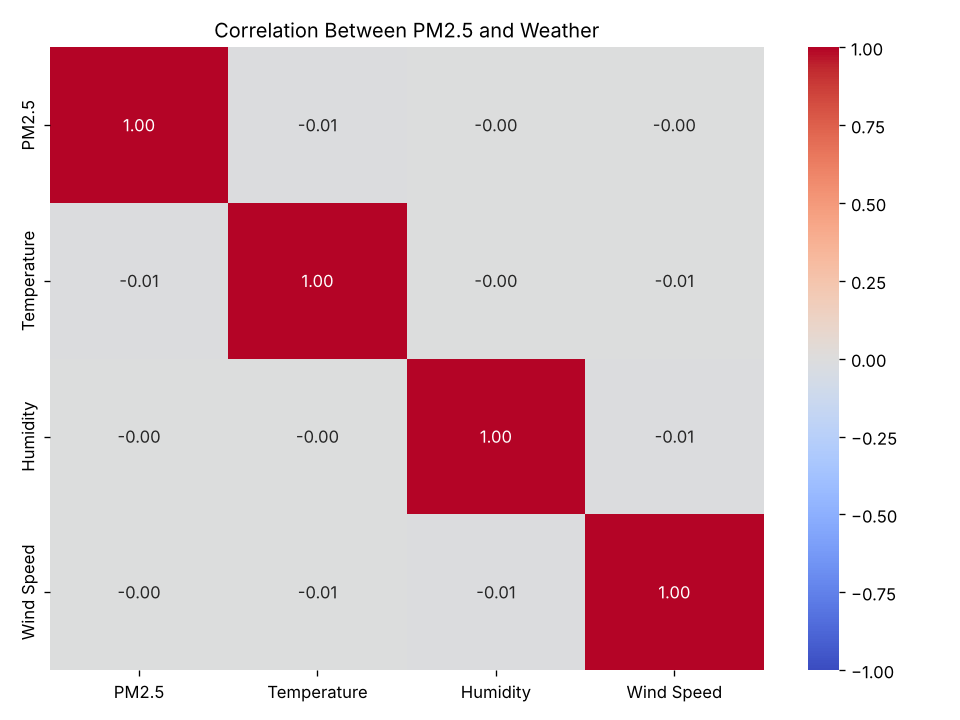
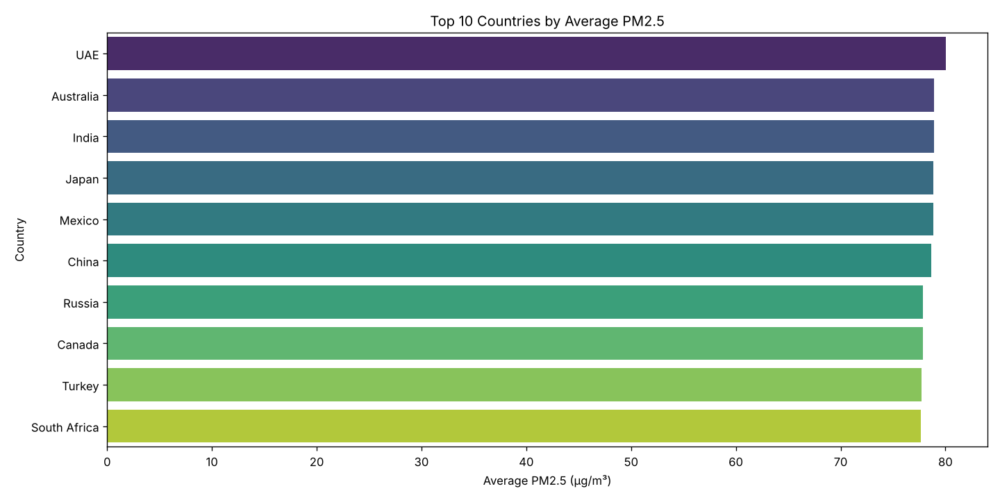
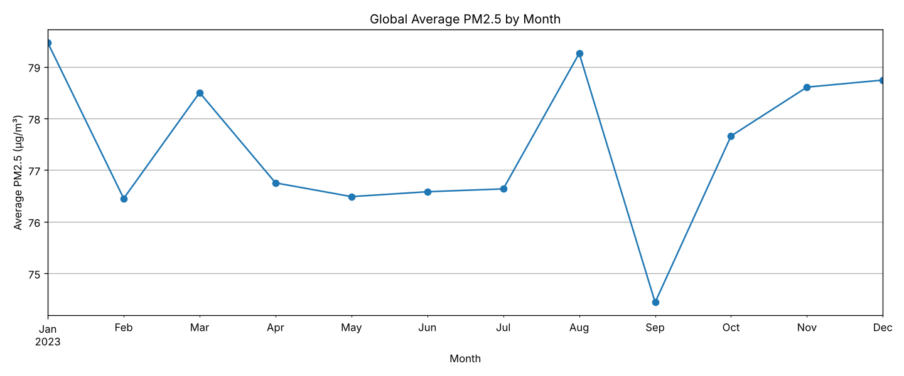
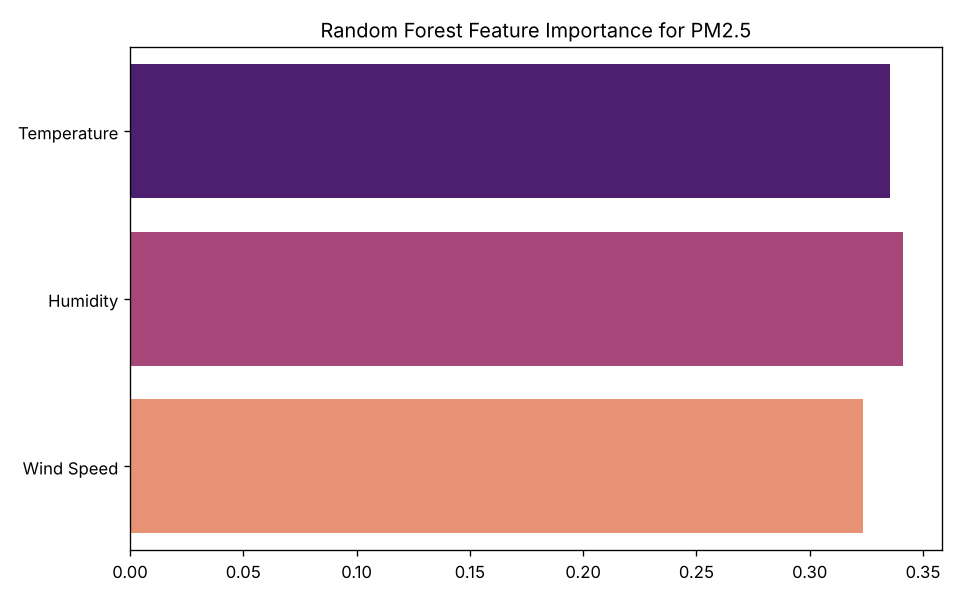

# Global Air Quality Insights

Exploratory analysis of 10,000 air-quality readings across 20 cities in 19 countries (Jan–Dec 2023), plus a regression model that tries to predict PM2.5 from the weather.

**The headline finding is a negative one:** weather explains none of the variation in PM2.5 in this dataset. The model does slightly *worse* than simply guessing the average, and the data's statistics strongly suggest it was randomly generated. The project shows how to check for that rather than reading meaning into noise.

## Why this project exists

Air pollution is one of the biggest global health problems, but the data about it is scattered. I wanted to take a large open dataset, look for patterns in pollution, temperature, humidity and wind, and see whether a model could predict PM2.5 (fine particulate matter, the pollutant most linked to health effects) from weather alone.

## Results

| Model | Test MSE | Test R² |
| --- | --- | --- |
| Baseline: always predict the mean | 1,752.86 | 0.00 |
| Random forest (100 trees) | 1,920.38 | **−0.10** |

R² measures how much of the variation a model explains: 1 is perfect, and 0 is no better than predicting the average. A negative R² means the random forest is fitting noise in the training data that doesn't carry over to new data.



Every correlation between PM2.5 and the weather variables is within ±0.01 of zero.

### Why there's no signal: the data looks synthetic

- **Flat distributions.** PM2.5 runs from 5 to 150 with a standard deviation of 41.9. That matches a uniform random distribution over that range almost exactly (145 / √12 ≈ 41.9), whereas real pollution data is skewed, with most days low and occasional spikes.
- **No geography.** Every country's average PM2.5 lands between 74.7 and 80.0, right at the midpoint of the range. Real data would show large gaps between countries.
- **No seasonality.** Monthly averages stay between 74 and 80 all year, even though real PM2.5 usually rises in winter.

The takeaway: the pipeline itself (cleaning → EDA → baseline → model) is sound, but this dataset can't support conclusions about real air quality. The natural next step is to rerun it on measured data, such as [OpenAQ](https://openaq.org/).

## Charts

| | |
| --- | --- |
|  |  |
|  | |

## Run it

```bash
git clone https://github.com/mercyy1/Global-Air-Quality-Insights.git
cd Global-Air-Quality-Insights
pip install -r requirements.txt
python air_quality_insights.py
```

This prints summary statistics and the model comparison, then writes the four charts to `images/`.

**Dataset:** [Global Air Quality Dataset on Kaggle](https://www.kaggle.com/datasets/waqi786/global-air-quality-dataset) (included as `global_air_quality_data_10000.csv`).

**Tools:** Python, pandas, Matplotlib, seaborn, scikit-learn.
